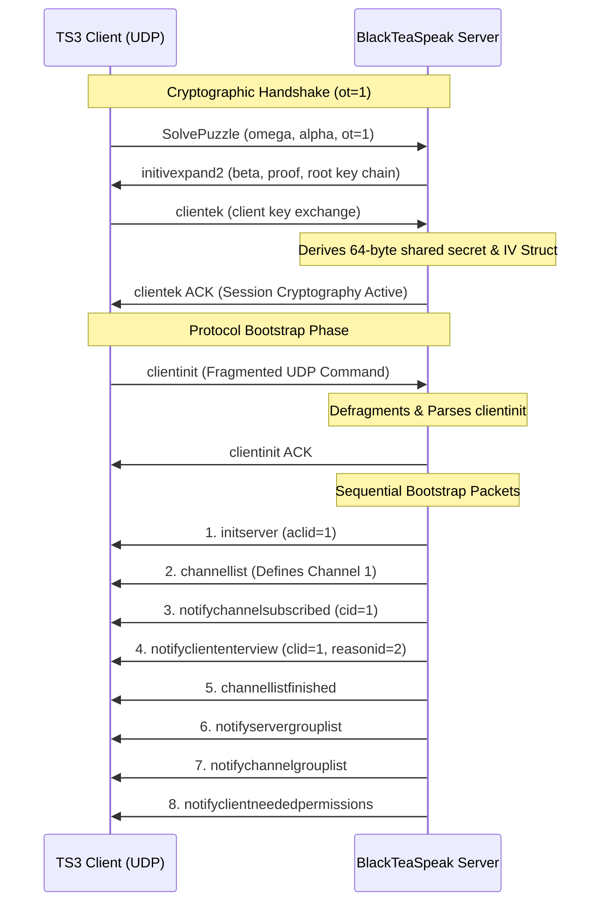

# BlackTeaSpeak Compat: Architectural & Protocol Documentation

This document serves as a permanent reference for the TeamSpeak 3 / TeaSpeak compatibility transport layer implemented in the `blackteaspeak_server`. It details the low-level UDP protocol reassembly, handshake flow, self-client registration requirements, and bootstrap sequence ordering.

---

## 1. High-Level Flow

---

## 2. Low-Level Transport Specifications

### Command Fragmentation & Reassembly
In the TS3 protocol, commands exceeding the path Maximum Transmission Unit (MTU) are segmented across multiple UDP packets. 
* **Header flag `0x10` (Fragmented)**: Identifies segments of a fragmented stream.
* **Boundary Rules**:
  - The **first** packet of a fragmented command has `0x10` set.
  - **Intermediate** packets have `0x10` cleared.
  - The **last** packet in the sequence has `0x10` set again.
* **Buffer Management**: Our read loop inside [teaspeak_transport.rs](file:///d:/projekt/BlackTeaSpeak/BlackTeaSpeak-Server/src/teaspeak_transport.rs) tracks this using `session.command_fragment_active` and accumulates fragments in `session.command_fragment_buffer`. A boundary flip resets the active flag, triggering reassembly decompression and UTF-8 conversion.

### Cryptographic Shared Secret & Slicing
* Slicing `session.shared_secret` to `[0..20]` is standard for older protocol variants but breaks key derivation under the NewProtocol flag. The full 64-byte secret (derived via ECDH key exchange) must be passed to `derive_iv_struct` to successfully decrypt post-handshake command sequences.

---

## 3. Protocol Bootstrap Phase Alignment

To prevent client-side assertions or silent disconnects during loading, commands must be transmitted in a strict logical sequence.

### A. Channel Tree Definition Before Client Entry
A major root cause of client disconnects (`Error while parsing packet: not connected`) is receiving views (`notifycliententerview`) for client IDs mapped to channels that do not yet exist in the client's memory.
* **Mismatched Flow (Broken)**: Sending `notifycliententerview` before `channellist` causes the client to process a client placement command inside a non-existent channel, discarding the packet and entering a disconnected state.
* **Aligned Flow (Working)**:
  1. **`channellist`**: Populates the default channels.
  2. **`notifychannelsubscribed`**: Registers client interest in the channels.
  3. **`notifycliententerview`**: Maps the client to the channel structure.

### B. Self-Client Registration (`clid=1`, `reasonid=2`)
The official TS3 client executes strict validation checks on its own client reference during the initial connection state transition:
* **The Self-View Identifier**: The client must receive its own view entrance notification targeting the actual self ID (`clid=1`). Attempting to proxy this with a dummy bot (e.g. `clid=2`) leaves the client's internal self-view uninitialized, causing later query assertions to fail.
* **The Reason ID (`reasonid=2`)**: When `clid == self_client_id`, the notification's `reasonid` must be set to `2` (`VREASON_SYSTEM`). Setting this to `0` or omitting it triggers a client assertion checking that you cannot have a standard client entrance event targeting your own ID unless it is a system bootstrap action.
* **View Properties**: The self-view notification must contain `client_totalconnections=1` and dynamically match properties (`client_unique_identifier`, `client_nickname`) parsed during the initial `clientinit` puzzle solving.

---

## 4. Post-Connection Robustness

To ensure compatibility with query utilities and status bars, the server catches common post-connection polling commands:
* **`clientgetvariables` / `servergetvariables`**: Rather than sending a default empty status, the server responds with fully populated, protocol-compliant `notifyclientupdated` and `notifyserverupdated` sequences containing escaping format tokens (e.g. `\s` for spaces, `\\` for backslashes).
* **Fallback Command Handler**: Commands like `connectioninfoautoupdate` or `channelsubscribeball` receive a clean `error id=0 msg=ok` payload, avoiding command execution timeouts.
